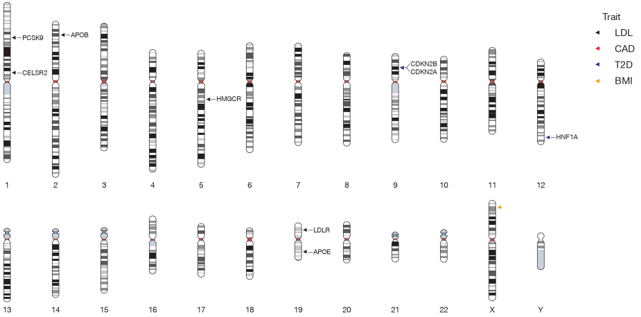
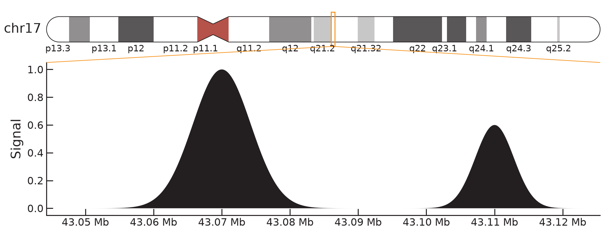
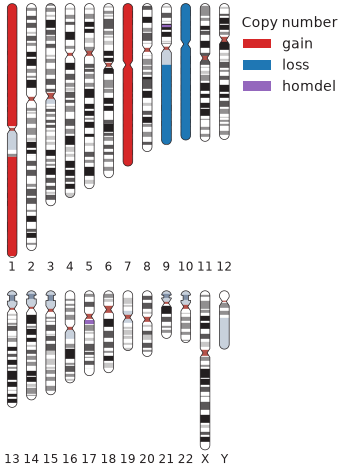
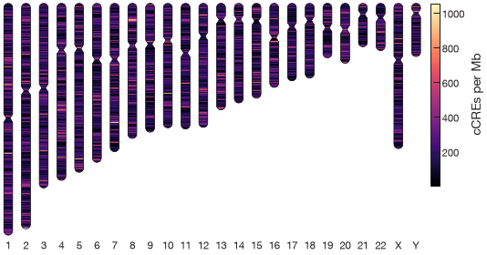

# pqplot

Chromosome ideograms and karyograms for matplotlib.

## Description

pqplot draws banded chromosomes and puts your data on them. It covers a single
ideogram over a locus plot and whole karyotypes, vertical or horizontal. Data
can go on the bodies as painted categories or values, or in tracks beside them
as marks, labels, scatter, lines, areas, heatmaps and intervals. It also has
helpers for genome-wide plots such as Manhattan plots.

Every chromosome and track is a plain matplotlib Axes with positions in bp. You
can call any matplotlib method on it. Every entry point takes `ax=None`. Without
an Axes, it makes a figure sized to the content. With one, it fills that slot of
your figure. Input is any table with columns (polars, pandas, pyarrow, a dict)
or plain arrays. Chromosome names match across `chr1` and `1`.

Bundled assemblies are hg19, hg38, hs1 (T2T-CHM13), mm10 and mm39. Any other
genome works from a `.chrom.sizes` or `.fai` file, with an optional centromere
BED.

## Getting Started

### Dependencies

* Python 3.12 or later
* matplotlib 3.10 or later
* NumPy 2.2 or later

### Installing

pqplot is not on PyPI yet. Install it from a checkout:

```
uv add path/to/pqplot
```

### Executing program

A karyotype with GWAS hits as marks and gene names as labels:

```python
import pqplot as pqp

hg38 = pqp.Genome.bundled("hg38")
kary = pqp.Karyogram(hg38, groups=2, align="centromere",
                     tracks=[pqp.Track("hits", side="after", size=5)])
kary.track("hits").mark(hits, pos="pos", color="trait")
kary.track("hits").label(genes, pos="pos", text="gene")
kary.legend(title="Trait")
kary.figure.savefig("karyotype.svg")
```



An ideogram over your own locus plot, with x in bp:

```python
import matplotlib.pyplot as plt

locus = pqp.Region.parse("chr17:43,044,295-43,125,483")
fig, (head, body) = plt.subplots(2, 1, height_ratios=[1, 3])
ideo = pqp.ideogram(hg38[locus.chrom], ax=head)
body.plot(pos, signal)
body.set_xlim(locus.start, locus.end)
ideo.zoom(locus, into=body)
```



Painting chromosome bodies by category or by value:

```python
kary = pqp.Karyogram(hg38, groups=2)
kary.paint(segments, start="start", end="end", color="state",
           palette={"gain": "tab:red", "loss": "tab:blue"})

kary = pqp.Karyogram(hg38, bands=False)
heat = kary.paint(bins, start="start", end="end", value="per_mb", cmap="magma")
kary.colorbar(heat, label="cCREs per Mb")
```




The [`gallery/`](gallery) scripts hold the full code for these figures and for
data tracks, homolog pairs, genome-wide plots and unbanded assemblies. Each
script ends with a figure named `fig`. The tests render them against the images
in `tests/baseline/`.

## Help

* Chromosome and track panels are child Axes of a hidden host Axes. They are
  not in `fig.axes`, and `plt.gca()` does not return them. Get them with
  `kary.panel(chrom, track=None)` or `kary.panels(track=None)`.
* Labels do not count in the layout. Size their track to fit the longest
  label, or labels run into the next chromosome.
* A legend and a colorbar both sit at the top right of the karyogram. Draw one
  or the other.
* Docstrings document every public name. Read them with `help()`:

```
python -c "import pqplot; help(pqplot.Karyogram)"
```

## Authors

Christian Ramirez (christian.ramirez1@umassmed.edu)

## License

This project is licensed under the MIT License. See the [LICENSE](LICENSE) file
for details.

## Acknowledgments

* Cytobands for hg19, hg38, mm10 and mm39 come from the
  [UCSC Genome Browser](https://genome.ucsc.edu) database, built on NCBI
  assemblies.
* hs1 cytobands come from the
  [T2T Consortium](https://github.com/marbl/CHM13) and are released under CC0.
* [pyideogram](https://github.com/Balthasar-eu/pyideogram),
  [tagore](https://github.com/jordanlab/tagore) and
  [karyoploteR](https://bioconductor.org/packages/karyoploteR) shaped the
  design. pqplot shares no code with them.
